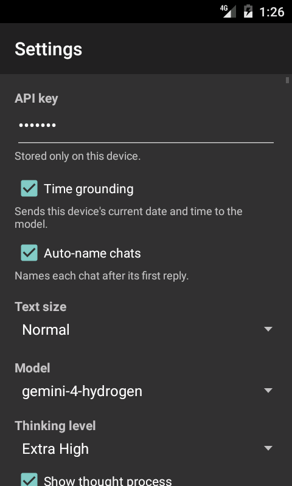
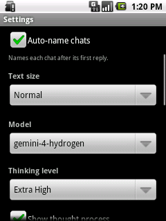

# Gemini Chat: Legacy Android Client

A zero-dependency native Gemini API client built for legacy Android devices starting at **Android 2.1 Eclair (API 7)**, compiled to roughly **153 KB** with no AndroidX, Play Services, or Kotlin runtime.

Current release: **[v0.8.9](https://github.com/baopemp/gemini-chat-legacy/releases/tag/v0.8.9)** (`versionCode 89`)

## Screenshots

| Chat (Android 4.4) | Live Voice (Android 4.4) | Settings (Android 5.0) | Legacy UI (Android 2.1) |
| :---: | :---: | :---: | :---: |
|  |  |  |  |

## Notable Features

- **Modern Gemini & Gemma models:** Supports free-tier `gemini-4-hydrogen`, Gemini 3.x Flash/Lite, and Gemma 4 (`gemma-4-31b-it`, `gemma-4-26b-a4b-it`), plus custom model IDs for paid Gemini 4 models (`gemini-4-neon`, `gemini-4-carbon`, `gemini-4-argon`).
- **Streamed replies & reasoning:** Real-time SSE streaming with automatic 5xx retry, stop-and-keep partial replies, configurable thinking levels (`Minimal`, `Low`, `Medium`, `High`, `Extra High`), and an inspectable **Show Thought Process** dialog.
- **Gemini Live voice chat:** Two-way real-time voice over native RFC 6455 WebSockets (`gemini-3.8-live`, `gemini-3.8-live-extended-thinking`, `gemini-3.1-flash-live-preview`), push-to-talk and hands-free modes with echo gating, live speech-to-text streaming into the input box (`gemini-3.5-transcribe-live`), 30 selectable voices, chat history handoff, and automatic session resumption.
- **Read Aloud:** Long-press any model reply to stream spoken audio via the Gemini Interactions API (`gemini-3.8-flash-lite-tts`, `gemini-3.8-flash-tts`, `gemini-3.1-flash-tts-preview`) in your chosen voice, stripping Markdown/code/rules cleanly.
- **Rich native rendering:** Zero-WebView Markdown formatting (headings, bold/italic, lists, quotes, tables, fenced code blocks with one-tap copy), readable LaTeX math (`$...$` / `$$...$$`) using Android 2.x-safe Unicode glyphs, Emoji 18 to `:shortcode:` conversion for old system fonts, and adjustable message text size.
- **Multimodal & chat management:** Image attachments on Android 2.2+ (API 8+), optional device date/time grounding, automatic chat naming, custom system instructions, message edit/resend/regenerate/share/delete actions, SQLite persistence, and chat/settings backup & restore (SAF on Android 4.4+, built-in file browser on older versions).
- **Legacy-first engineering:** Runs cleanly from Android 2.1 (API 7, 256 MB RAM devices) up to modern Android, with automatic TLS 1.2 + SNI enablement on Android 4.1-4.4 (`TLSSocketFactory`), Holo/Material theme adaptation, and SHA-1 v1 + v2/v3 APK signing.

## Installation & Setup

1. Download `gemini_chat_v0.8.9.apk` from [GitHub Releases](https://github.com/baopemp/gemini-chat-legacy/releases/latest) (or build it from source below) and install it (`adb install -r gemini_chat_v0.8.9.apk` preserves existing chats and settings).
2. Open **Settings** and paste a Gemini API key from [Google AI Studio](https://aistudio.google.com/apikey) (free-tier keys work out of the box).
3. Choose a model and start chatting. Gemini Live requires a microphone and a stable network connection.

Your API key is stored locally in the app's private preferences and is sent only to `generativelanguage.googleapis.com`.

## Building from Source

Requires **JDK 8+** (with `keytool`), **Python 3**, and **`curl`**. There is no Gradle project: Java sources in `java/` compile against the Android 2.1 (API 7) stub jar into smali, and `apktool` assembles the final APK.

```bash
./scripts/build_java.sh                        # compile java/ -> android_project/smali (after Java edits)
./scripts/build_apk.sh                         # run smali audits, build, zipalign, and sign
adb install -r build/gemini_chat_v0.8.9.apk    # install while keeping chats and settings
./tests/run_tests.sh                           # JVM bytecode verification (-Xverify:all) + unit tests
```

The first build downloads `apktool` and `uber-apk-signer` into `tools/` via `scripts/download_tools.sh` and creates a local signing keystore in `keystore/`. Back up your keystore: updating an installed APK requires signing with the same key, and v1 SHA-1 signatures are preserved automatically for Android 2.1-4.2 compatibility.

## Project Layout

| Path | Description |
| :--- | :--- |
| `android_project/` | Apktool project containing `AndroidManifest.xml`, `apktool.yml` (versioning), `res/`, `assets/emoji.tsv`, and `smali/` |
| `java/` | Java 8 sources (API 7 compatible) compiled to smali by `scripts/build_java.sh` |
| `java_sources/` | Readable jadx reference decompilations of the remaining hand-written smali classes (non-compilable) |
| `scripts/` | Build scripts (`build_java.sh`, `build_apk.sh`), tool downloader, emoji table generator, and smali static audits |
| `tests/` | Dex2jar-based JVM verification & unit test suite, Live API CLI checks, and mock emulator servers |
| `tools/` | `Dex2Smali` / `Smali2Dex` helpers (downloaded JARs are git-ignored) |
| `keystore/` | Local signing keystore (git-ignored, created on first build if absent) |
| `docs/` | `ARCHITECTURE.md`, `CHANGELOG.md`, and `screenshots/` |

See [docs/ARCHITECTURE.md](docs/ARCHITECTURE.md) for technical internals and [docs/CHANGELOG.md](docs/CHANGELOG.md) for the full release history.

## Credits

- Build tools: [Apktool](https://github.com/iBotPeaches/Apktool) and [uber-apk-signer](https://github.com/patrickfav/uber-apk-signer) (Apache-2.0), downloaded automatically on first build.
- Emoji dataset: Python [`emoji`](https://pypi.org/project/emoji/) package tracking official Unicode emoji data.
- Built with the assistance of AI.

## License

[MIT](LICENSE) © 2026 baopemp
