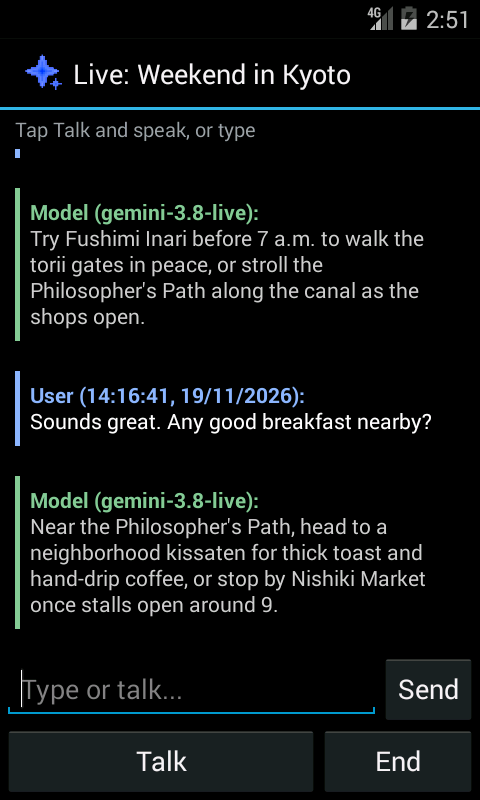
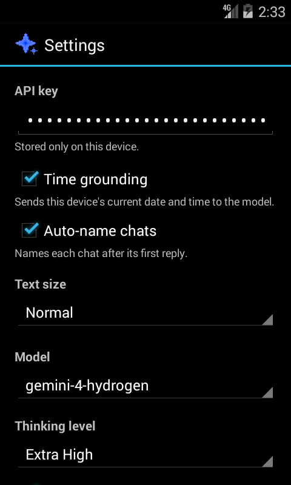

# Gemini Chat: Legacy Android Client

A lightweight native Gemini API client for legacy Android devices running Android 2.1 (API 7) and newer, built with no external libraries.

## Screenshots

| Chat (Android 4.4) | Live Voice (Android 4.4) | Settings (Android 4.4) | Android 2.1 Eclair |
| :---: | :---: | :---: | :---: |
|  |  |  |  |

## Features

- Chat with Gemini 4 (`gemini-4-hydrogen`), Gemini 3, and Gemma 4 models, or enter any custom model ID.
- Stream replies in real time with configurable thinking levels (Minimal to Extra High), inspectable thought summaries, automatic retries, and stop-and-keep partial replies.
- Talk hands-free or push-to-talk with Gemini Live, complete with live speech transcription in the input box, 30 selectable voices, chat history handoff, and automatic reconnect.
- Listen to any reply with streamed Read Aloud text-to-speech in your chosen voice.
- Read formatted Markdown, code blocks with one-tap copy, readable Unicode LaTeX math, `:shortcode:` emoji for legacy fonts, and adjustable text sizes.
- Attach images (Android 2.2+), enable device date and time grounding, auto-name conversations, edit or regenerate messages, and back up or restore chats and settings.
- Run smoothly from Android 2.1 (API 7) up to modern Android, with automatic TLS 1.2 support enabled on Android 4.1 to 4.4.

## Setup

1. Download `gemini_chat_v0.8.9.apk` from [Releases](https://github.com/baopemp/gemini-chat-legacy/releases/latest) and install it (`adb install -r` keeps your chats and settings).
2. Open Settings and paste a Gemini API key from [Google AI Studio](https://aistudio.google.com/apikey). Free-tier keys work.
3. Pick a model and start chatting.

Your API key stays on your device in private app preferences and is sent only to `generativelanguage.googleapis.com`.

## Building from Source

Requires JDK 8+ (`keytool`), Python 3, and `curl`.

```bash
./scripts/build_java.sh                        # compile java/ to smali after Java edits
./scripts/build_apk.sh                         # audit, build, align, and sign
adb install -r build/gemini_chat_v0.8.9.apk    # install without clearing data
./tests/run_tests.sh                           # optional JVM bytecode and unit tests
```

The first build downloads `apktool` and `uber-apk-signer` into `tools/` and generates a local keystore in `keystore/`. Keep your keystore if you plan to install updates without losing local chats.

## Project Layout

| Path | Description |
| :--- | :--- |
| `android_project/` | Apktool project (manifest, resources, `apktool.yml`, emoji table, smali) |
| `java/` | Java sources compiled to smali by `scripts/build_java.sh` |
| `java_sources/` | Readable reference decompiles of the remaining hand-written smali classes |
| `scripts/` | Build scripts, tool downloader, and smali static checks |
| `tests/` | JVM test suite, Live API test tools, and local mock servers |
| `docs/` | `ARCHITECTURE.md`, `CHANGELOG.md`, and `screenshots/` |

## Credits

- Built with [Apktool](https://github.com/iBotPeaches/Apktool) and [uber-apk-signer](https://github.com/patrickfav/uber-apk-signer) (Apache-2.0).
- Emoji shortcodes generated from the Python [`emoji`](https://pypi.org/project/emoji/) dataset.
- Built with the assistance of AI.

## License

[MIT](LICENSE) © 2026 baopemp
